# IKARUS Store

Widgets, plugins and themes for IKARUS, the desktop overhaul for KDE Plasma and the Steam Deck.
IKARUS reads `catalog.json` from this repo when you press **Check the store**. It never reads it by itself.

Made by AyeJayS47 [IKARUS Software].

## Install something

1. Open **IKARUS Settings** and go to **Widgets**.
2. Press **Check the store**.
3. Open **Widgets**, **Plugins** or **Themes** under *Available* and press **Install** on the one you want.

IKARUS downloads the package and compares it with the checksum in the catalog. Then it shows you who made it, its version and what it asks for. Nothing is installed until you say yes.

- A widget shows up in the Edit library of the Magic Dock, the island or Home.
- A plugin is installed switched off. Switch it on in IKARUS Settings, under System, Modules, Plugins.
- A theme shows up in IKARUS Settings under Look & sound, Theme.

To take something away again, press **Remove** in the same place.

## What is in the store

### Widgets

| | Name | What it does |
|---|---|---|
| 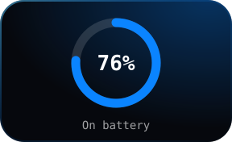 | **Battery ring** | Your battery as a ring with the charge in the middle. It turns amber at 20% and shows when the charger is in. Version 1.0 by AyeJayS47. Verified. Asks for: files. |
| 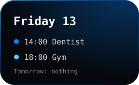 | **Today** | Today's events from IKARUS Calendar, with tomorrow's on a wide card. Tap an event to open it. Version 1.0 by AyeJayS47. Verified. Asks for: calendar. |
| 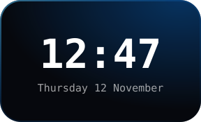 | **Clock** | The time, with the date on Home. Copy it to start your own widget. Version 1.0 by AyeJayS47. Verified. |
| 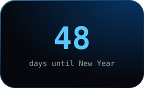 | **Days until** | The days left until a date you choose. It counts to New Year until you set your own. Version 1.0 by AyeJayS47. Verified. |
| 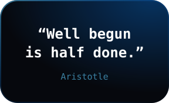 | **Daily quote** | One short quote a day on Home. It works offline, and you can swap in your own lines. Version 1.0 by AyeJayS47. Verified. |
| 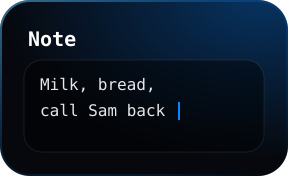 | **Quick note** | A small note on Home. Type in it and it is still there after a restart. Version 1.0 by AyeJayS47. Verified. |
| 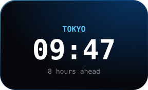 | **World clock** | The time in another city. Tap its dock key for the next city. Version 1.0 by AyeJayS47. Verified. |

### Plugins

| | Name | What it does |
|---|---|---|
| 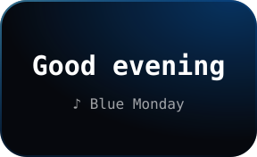 | **Hello card** | A small Home card that says hello and shows what's playing. Copy it to start your own plugin. Version 1.0 by AyeJayS47. Verified. Asks for: media. |
| 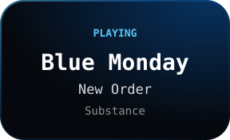 | **Now playing** | A small Home card with the song, the artist and the album that is playing. It can also show each new song on the island. Version 1.0 by AyeJayS47. Verified. Asks for: media. |
| 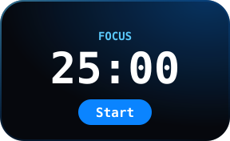 | **Pomodoro** | Focus for 25 minutes, then rest for 5. It adds a Home card, a countdown on the island and “pomodoro” in Spotlight. Version 1.0 by AyeJayS47. Verified. |

### Themes

| | Name | What it does |
|---|---|---|
| 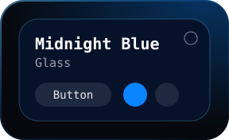 | **Midnight Blue Glass** | Deep blue glass for late evenings. Version 1.0 by AyeJayS47. Verified. |

## Verified and Unverified

A package signed by AyeJayS47 shows **Verified · AyeJayS47** in IKARUS. The signature covers every file, so a package that was changed afterwards is refused.
Anything else shows **Unverified**. That only means IKARUS cannot tell who made it.
Widgets and plugins are small Python programs that run inside IKARUS, so install them only from people you trust. A theme is one settings file and a picture, with no code.

## Send in your own

1. Make your widget, plugin or theme. The guides come with IKARUS, in `~/IKARUS/apps/island/plugins/`: `README.md` for plugins and themes, `widgets/README.md` for widgets.
2. Fork this repo and put your package folder in `submissions/`, for example `submissions/my-clock/`.
3. Add a `preview.png` or `preview.svg` and write one or two plain sentences in `description`.
4. Open a pull request. Say what the package does and why it asks for each permission.

Each package is read and tested before it goes in. Packages that pass are signed and added to the catalog.

## The checks a package must pass

- It has a valid `widget.json`, `plugin.json` or `theme.json`, with an id, a name, an author and a version such as `1.0`.
- Its Python compiles. The check never runs it.
- It has a preview picture (png, jpg, svg or webp) of 1 MB or less.
- It is at most 400 files and 20 MB, with no links inside.
- It holds no secrets or personal details: no private keys, tokens, passwords, e-mail addresses or home-folder paths.
- It asks only for the permissions it uses, and its description says honestly what it does.
- A theme is one `theme.json` and one picture. It cannot contain code.

## What is in this repo

| Path | What it is |
|---|---|
| `catalog.json` | The catalog IKARUS 2.0 reads: every item, its download address, checksum and signature |
| `widgets.json` | The same widgets in the older format, for IKARUS 1.8 and 1.9 |
| `packages/` | The packages: `.ikwidget`, plugin `.zip` and `.iktheme` files |
| `previews/` | One preview picture per item |
| `submissions/` | Packages people sent in that are waiting to be checked |

## Help

Found a problem with an item, or with the store? Open an issue here, or use **Report a bug** in IKARUS (the dashboard, Help).
IKARUS itself is at [AyeJayS47DEV/ikarus-releases](https://github.com/AyeJayS47DEV/ikarus-releases).

## Licence

IKARUS and the packages by AyeJayS47 are Copyright (c) 2026 AyeJayS47 [IKARUS Software]. All rights reserved. Other people's packages belong to their authors. See [LICENSE](LICENSE).
